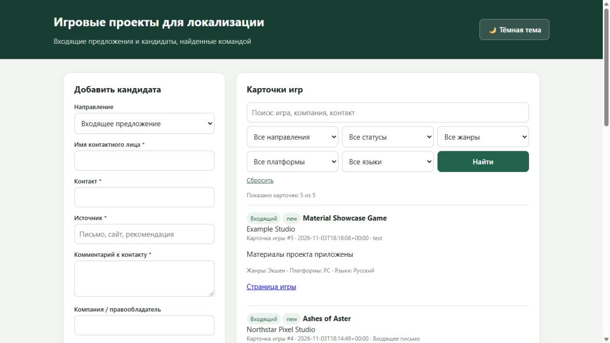
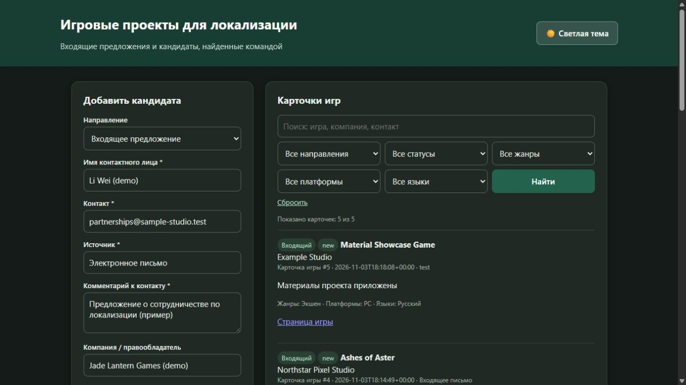
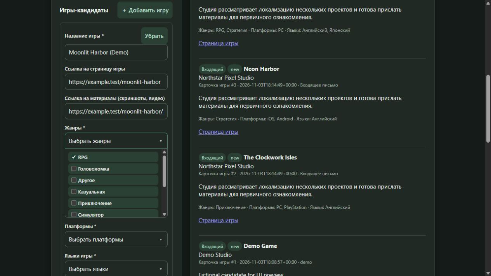
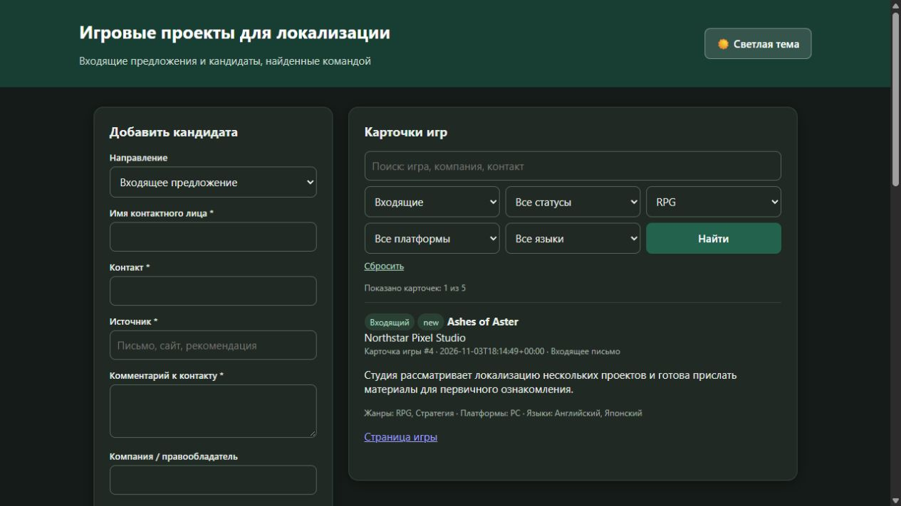
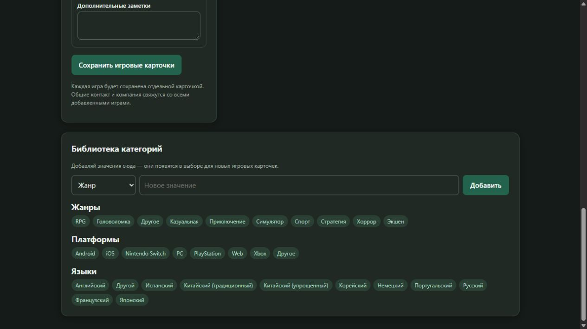
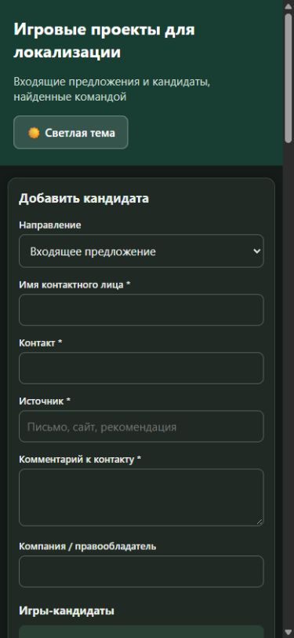

# Отчёт по практике VPk01.1 — регистрация входящих предложений игровых проектов

Дата актуализации: 2026-11-03. Реализация MVP и описанные проверки выполнены Codex в рамках работы над учебным проектом. Формулировки задания сверяются с предоставленным PDF «VPk01.1 Учебный проект».

## 1. Кому и какую задачу решает проект

Локальный прототип предназначен для команды компании, которая рассматривает игры от разработчиков для возможного сотрудничества по локализации и публикации. Он принимает входящие предложения, сохраняет сведения о контактном лице и каждой игре отдельной карточкой, чтобы сотрудникам было удобно просматривать и отбирать кандидатов. В MVP форма заполняется сотрудником при регистрации обращения; публичная ссылка для самостоятельного заполнения разработчиком пока не реализована.

## 2. Входные данные

`POST /lead` принимает JSON. Обязательные по учебному заданию поля: `name` — имя контактного лица, `contact` — способ связи, `source` — источник обращения, `comment` — сообщение или краткое описание запроса. Также передаются компания/правообладатель и непустой список `games`. Для каждой игры указывается название; дополнительно можно передать ссылку на игру, ссылку на материалы, заметки, жанры, платформы и языки.

В интерфейсе предусмотрены категории направления обращения, жанров, платформ и языков. MVP ограничен первичной регистрацией входящего предложения: финансовые условия и продуктовая аналитика в форме не собираются.

## 3. Выход / результат

После успешного запроса каждая игра сохраняется отдельной записью в SQLite со статусом `new`; общие сведения компании и контакта связываются с карточками. Для каждой созданной карточки в таблицу `events` добавляется событие `New lead saved: <id>`. Endpoint возвращает HTTP 201 и идентификаторы карточек. Это внутреннее уведомление в журнале событий; отправка email или сообщения разработчику не реализована.

## 4. Архитектура

1. **Форма / клиент** отправляет JSON с данными контакта и одной или несколькими играми.
2. **`POST /lead`** проверяет тип и состав запроса, обязательные поля, игры и значения категорий.
3. **SQLite** в одной транзакции сохраняет карточки игр и соответствующие события в таблицах `leads` и `events`.
4. **Результат** — HTTP 201 с ID созданных карточек; интерфейс показывает новые карточки в общем списке.
5. **Ошибки** валидации возвращают HTTP 400; ошибка базы возвращает HTTP 500 и записывается в серверный лог.

## 5. Как запустить

Требуется Python 3.10 или новее. Из папки проекта:

```powershell
python -m venv .venv
.venv\Scripts\Activate.ps1
pip install -r requirements.txt
python app.py
```

Затем открыть `http://127.0.0.1:5000`. Подробные инструкции и пример запроса находятся в [README.md](README.md).

## 6. Демонстрация

Выбран формат демонстрации скриншотами. Кадры сняты в браузере на фиктивных данных; форма не отправлялась, новые записи в базу через демонстрационное заполнение не добавлялись.

**01 — список игровых карточек**



**02 — заполнение входящей заявки**



**03 — раскрытый множественный выбор категорий**



**04 — фильтрация по жанру RPG**



**05 — библиотека жанров, платформ и языков**



**06 — мобильная раскладка**



## 7. Ошибки и как решал(а)

- **Пустые или некорректные обязательные поля.** Добавлена серверная проверка; endpoint возвращает HTTP 400 с описанием ошибки.
- **Некорректная структура списка игр или категорий.** Проверяются список игр и наличие выбранных значений в библиотеке категорий; ошибочные значения отклоняются до записи.
- **Повтор категории.** Уникальность категории обеспечивается SQLite без учёта регистра; повторное добавление возвращает HTTP 409.
- **Ошибка при работе с базой.** Исключение SQLite логируется, клиент получает HTTP 500 с безопасным сообщением.
- **Частичная запись нескольких карточек.** Запись игр и событий выполняется транзакционно, чтобы данные одного запроса не сохранялись частично.

Проверки Flask test client выполнялись на отдельной временной SQLite-базе. В том числе проверены несколько игр за запрос, фильтры, ошибки валидации и имитация сбоя БД. Восемь тестовых payload-примеров вернули HTTP 201; битый JSON и отсутствие контакта дали HTTP 400. Подробности приведены в README.

## 8. Что улучшить в v2

- Разделить публичную форму разработчика и внутреннюю карточку сотрудника. Разработчик получает ссылку на форму и указывает только известные ему данные; сотрудник дополняет и проверяет запись во внутренней части.
- Добавить сохранение черновика, проверку дублей компаний/игр, историю изменений и статусы рассмотрения.
- Подготовить двуязычный интерфейс формы на английском и упрощённом китайском; внутреннюю панель оставить на русском. Не делать китайский обязательным языком заполнения: английский может быть удобнее конкретному партнёру.
- Для внешней формы запросить минимальный набор: название компании и игры, контакт, ссылка на игру и/или страницу в магазине, краткое описание, жанр, платформы, текущие языки, ссылка на материалы. Поля, которые разработчик не знает или не готов раскрыть, оставить необязательными.
- Добавить авторизацию, резервное копирование и развёртывание, когда этого потребуют рабочий процесс и учебное задание.

### Предлагаемый вариант формы для партнёров

Оптимально не отправлять партнёру текущую внутреннюю форму целиком. В текущей версии сотрудник сам регистрирует входящее обращение. Возможное улучшение этого проекта — внешняя форма на английском и упрощённом китайском с короткими полями; сотрудник сможет проверять и дополнять полученные сведения во внутренней карточке. Поля финансовых условий и аналитики не нужны для первичной регистрации.
